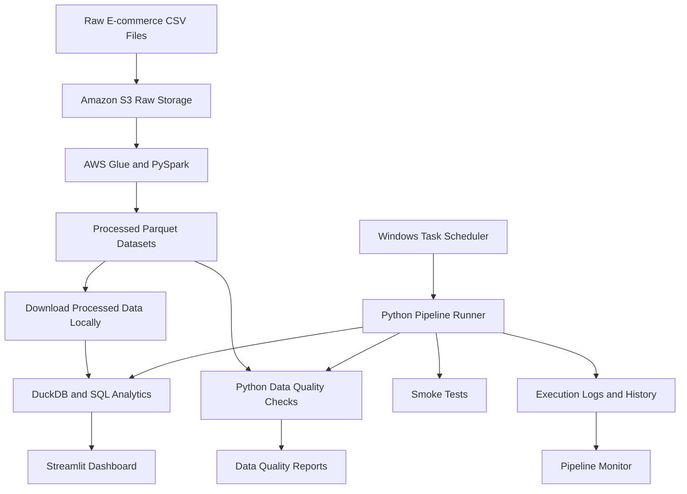

# E-Commerce Data Engineering Pipeline

## Project Overview

An end-to-end e-commerce data engineering portfolio project demonstrating cloud-based data transformation, local analytics, data quality validation, and pipeline monitoring.

The pipeline processes synthetic e-commerce datasets, transforms raw data using AWS Glue and PySpark, stores processed datasets in Parquet format, and uses DuckDB and SQL to generate analytical outputs. Python scripts validate data quality, record execution history, and support scheduled local execution.

## Technology Stack

| Technology | Purpose |
|---|---|
| Python | Pipeline orchestration, validation, and monitoring |
| SQL | Analytical queries and aggregations |
| Amazon S3 | Raw and processed data storage |
| AWS Glue | Managed data transformation jobs |
| PySpark | Distributed data processing |
| Parquet | Processed analytical data storage |
| DuckDB | Local analytical queries |
| Pandas | Data handling and reporting |
| Streamlit | Interactive analytics dashboard |
| Windows Task Scheduler | Scheduled local execution |
| Git and GitHub | Version control and project hosting |

## Architecture



**Architecture note:** AWS Glue transformation and local analytics orchestration are separate stages. The local runner operates on processed datasets already available in the project; it does not automatically trigger the AWS Glue job.

## Dataset Overview

The project uses synthetic e-commerce data covering customers, products, orders, website sessions, search trends, and inventory.

| Dataset | Raw records |
|---|---:|
| Customers | 150 |
| Products | 10 |
| Orders | 2,500 |
| Website sessions | 3,000 |
| Search trends | 258 |
| Inventory | 10 |

## Processed Analytical Datasets

The pipeline produces the following analytical datasets:

- **Enriched sales:** Sales data enriched with related information.
- **Daily sales:** Aggregated daily sales metrics.
- **Customer summary:** Customer-level analytical summaries.
- **Product summary:** Product-level analytical summaries.

Processed datasets are stored in Parquet format for analytical processing.

## Analytics and Data Quality

### Analytics

DuckDB and SQL are used to analyze the processed datasets, including:

- Total sales calculations.
- Daily sales aggregations.
- Customer-level summaries.
- Product-level summaries.

### Data quality

Python validation scripts check data consistency and business rules, including:

- Missing identifiers and required values.
- Duplicate order identifiers.
- Invalid prices and discounts.
- Sales calculation mismatches.

Data quality results are written to reports under `reports/data_quality/`.

### Monitoring and failure handling

The local pipeline runner executes project smoke tests, analytics, and data quality checks. It records execution status, duration, and errors in log files and a CSV execution history.

A separate pipeline monitor summarizes previous executions, including successful and failed runs.

## Verified Project Results

During the latest confirmed execution:

- 2,500 enriched sales records were processed by the analytics workflow.
- The data quality suite reported 12 checks passed and 0 failed.
- Daily sales contained 809 rows.
- Customer summary contained 150 rows.
- Product summary contained 10 rows.
- The local pipeline completed successfully in approximately 6 seconds.

These results describe the tested synthetic datasets and the latest confirmed run; results may change when the data or validation rules change.

## Running the Local Pipeline

### Prerequisites

- Python installed.
- Project dependencies installed in the virtual environment.
- Processed Parquet datasets available locally.

Activate the virtual environment if it is not already active, then run:

```powershell
python src/run_pipeline.py
```

Review the latest data quality summary:

```powershell
Get-Content reports/data_quality/data_quality_summary.txt
```

Review pipeline execution history and monitoring output:

```powershell
python src/pipeline_monitor.py
```

Run the Streamlit dashboard separately:

```powershell
streamlit run src/dashboard.py
```

## Project Structure

```text
ecommerce-data-pipeline/
├── data/
│   ├── raw/
│   └── processed/
├── src/
│   ├── analytics.py
│   ├── dashboard.py
│   ├── data_quality.py
│   ├── pipeline_monitor.py
│   ├── project_smoke_test.py
│   ├── run_pipeline.py
│   └── validate_data.py
├── reports/
│   └── data_quality/
├── logs/
│   ├── pipeline.log
│   └── pipeline_history.csv
├── docs/
│   └── data_engineering_challenges.md
├── .gitignore
├── README.md
└── requirements.txt
```

The structure above represents the intended layout; optional files and generated outputs may vary depending on the local setup.

## Key Engineering Learnings

- Transforming raw CSV data into analytical Parquet datasets.
- Using AWS Glue and PySpark for cloud-based data processing.
- Writing analytical SQL with DuckDB.
- Implementing data quality validation and reporting.
- Handling pipeline errors and tracking execution history.
- Scheduling local workflows with Windows Task Scheduler.
- Documenting data engineering challenges and potential solutions.

## Future Improvements

- Automate raw data ingestion and incremental processing.
- Introduce Apache Airflow for workflow orchestration.
- Add automated failure notifications.
- Integrate a cloud data warehouse when justified by project requirements.
- Expand automated unit tests and continuous integration.
- Optimize partitioning and small-file handling for larger datasets.

## Project Scope

This is a learning and portfolio project using synthetic e-commerce data. It demonstrates a combination of AWS-based transformation and local analytics orchestration. AWS Glue, local DuckDB analytics, and scheduled execution operate as distinct stages rather than a single fully automated cloud orchestration system.
