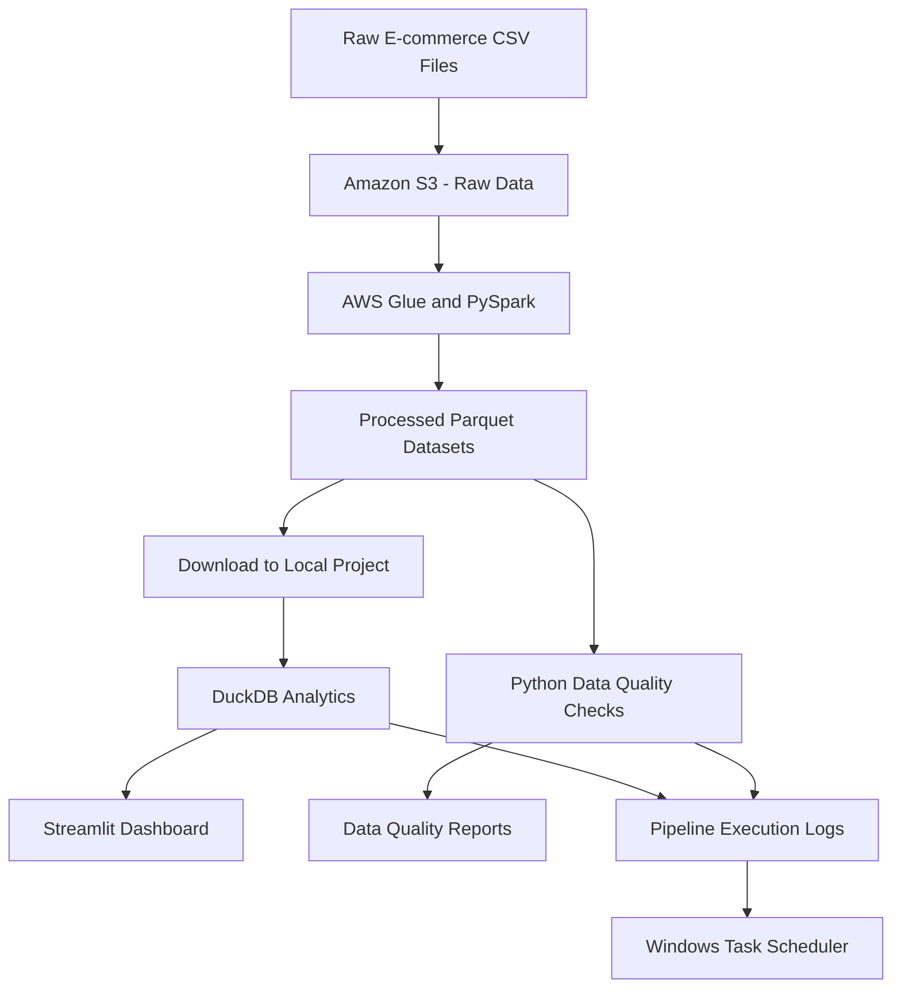

# E-Commerce Data Engineering Pipeline

## Project Overview

This project demonstrates an end-to-end e-commerce data engineering workflow using Python, SQL, AWS Glue, PySpark, Amazon S3, DuckDB, and Streamlit.

The project processes e-commerce datasets, creates analytical datasets, performs data quality checks, and records pipeline execution history.

## Technology Stack

- **Python:** Pipeline orchestration and validation scripts
- **SQL:** Analytical queries
- **Amazon S3:** Raw and processed data storage
- **AWS Glue and PySpark:** Distributed data transformation
- **DuckDB:** Local analytical database
- **Pandas:** Data handling and reporting
- **Streamlit:** Interactive analytics dashboard
- **Windows Task Scheduler:** Scheduled local pipeline execution
- **CSV and Parquet:** Data storage formats

## Pipeline Architecture

1. **Data ingestion:** E-commerce CSV datasets are stored locally and in Amazon S3.
2. **Data transformation:** AWS Glue processes the raw datasets and produces analytical Parquet datasets.
3. **Data download:** Processed datasets are downloaded from S3 for local analysis.
4. **Analytics:** DuckDB queries the processed data to calculate sales metrics, daily sales, top products, and customer summaries.
5. **Data quality:** Python checks for missing identifiers, duplicate order IDs, invalid prices or discounts, and sales amount mismatches.
6. **Dashboard:** Streamlit presents the analytics through an interactive dashboard.
7. **Orchestration:** A Python runner executes analytics and data quality scripts.
8. **Monitoring:** Logs and a CSV execution history record run status, duration, and errors.
9. **Scheduling:** Windows Task Scheduler can execute the local Python workflow on a schedule.


## Architecture Diagram



### Pipeline Flow

1. Raw e-commerce CSV datasets are stored in Amazon S3.
2. AWS Glue uses PySpark to transform the datasets into Parquet outputs.
3. The processed outputs are downloaded to the local project.
4. DuckDB runs analytical queries against the local processed datasets.
5. Streamlit displays the analytics in a dashboard.
6. Python data quality checks generate reports.
7. The Python runner records execution history and logs; Windows Task Scheduler launches the local workflow on its schedule.

## Processed Datasets

- Enriched sales
- Daily sales
- Customer summary
- Product summary

## Data Quality and Monitoring

The project generates data quality reports and maintains pipeline execution records.

- Missing-value and identifier checks
- Duplicate identifier checks
- Price, discount, and sales calculation validation
- Execution status and duration tracking
- Failure logging for troubleshooting

## Running the Local Workflow

Activate the project's virtual environment and run:

```powershell
python src/run_pipeline.py
```

The local runner executes the analytics and data quality scripts using the available processed datasets.

Run the dashboard separately with:

```powershell
streamlit run src/dashboard.py
```

## Project Structure

```text
ecommerce-data-pipeline/
├── data/
│   ├── raw/
│   └── processed/
├── src/
│   ├── analytics.py
│   ├── dashboard.py
│   ├── data_quality.py
│   └── run_pipeline.py
├── reports/
│   └── data_quality/
├── logs/
│   ├── pipeline.log
│   └── pipeline_history.csv
└── README.md
```

## Key Learning Outcomes

- Building data transformation workflows with AWS Glue and PySpark
- Working with Amazon S3 and Parquet datasets
- Performing analytical queries using DuckDB and SQL
- Implementing data quality validation
- Automating local workflows with Python and Windows Task Scheduler
- Tracking execution status and troubleshooting pipeline failures

## Future Improvements

- Add incremental data processing and automated S3 ingestion
- Integrate Apache Airflow for workflow orchestration
- Add automated alerts for pipeline failures
- Integrate a cloud data warehouse when required
- Add unit tests and continuous integration

## Project Scope

This is a learning and portfolio project. AWS Glue transformation and local analytics orchestration are separate stages; the current local runner executes analytics and data quality checks on the locally available processed datasets.
