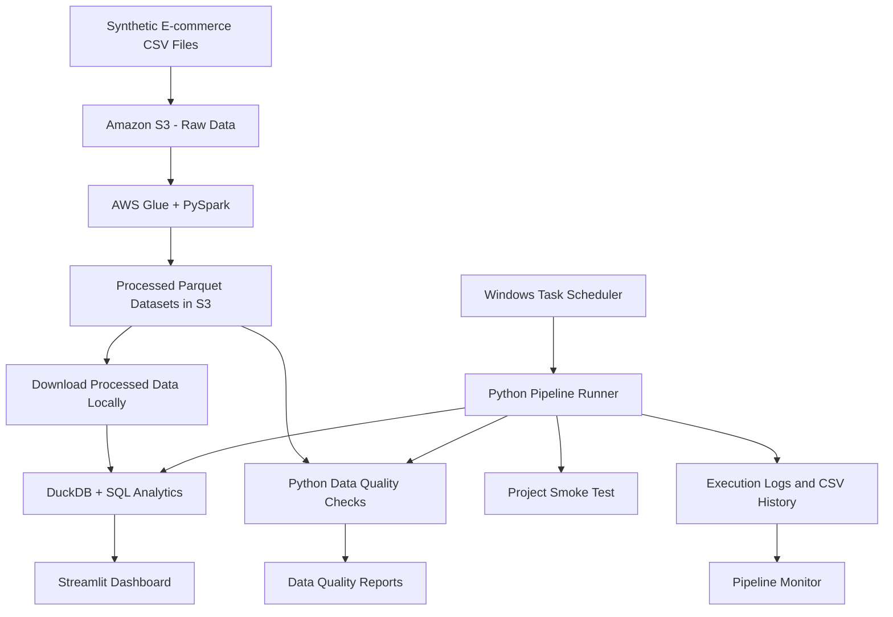

# E-Commerce Data Pipeline Architecture

## Overview

The project separates cloud-based data transformation from local analytics and monitoring.

## Data Flow

## Component Responsibilities

- **Amazon S3:** Stores raw and processed datasets.
- **AWS Glue and PySpark:** Transform raw datasets into Parquet outputs.
- **DuckDB and SQL:** Analyze locally available processed data.
- **Python data quality scripts:** Validate records and business rules.
- **Pipeline runner:** Executes local smoke tests, analytics, and quality checks.
- **Pipeline monitor:** Summarizes execution history.
- **Windows Task Scheduler:** Starts the local workflow on a schedule.
- **Streamlit:** Presents analytical results through a dashboard.

## Scope Note

The AWS Glue transformation and local Python orchestration are separate stages. The local runner does not currently trigger the Glue job automatically.
